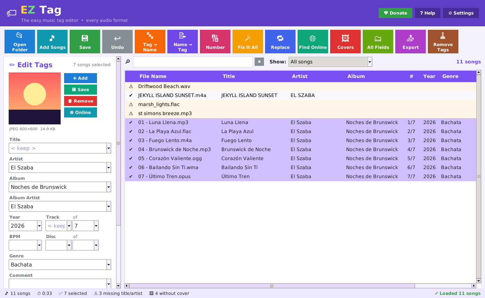

# EZ Tag

**The easy, colorful music tag editor for Windows.** Fix song titles, artists, albums, track numbers and cover art
for MP3, FLAC, M4A/AAC/ALAC, OGG, Opus, WMA, WAV, AIFF, APE, WavPack, Musepack, TTA, TAK, DSF, Speex, AC3 and more.
Free, by Dr. Szaba.

**⬇ [Download for Windows](https://github.com/DrSzaba/ez-tag/releases/latest/download/EZ-Tag-Setup.zip)** · 🌐 [Website](https://drszaba.github.io/ez-tag/) · 💚 Donate on Cash App: **$Szaba**



## Updates itself (new in 1.1)

When you open EZ Tag it quietly checks for a new version (at most every 6 hours) and downloads it in the
background. A yellow bar says it's ready: click **Restart & update now**, or keep working and it installs by itself
when you close EZ Tag. Your version is shown at the top right and in **Help → About · Updates**.
It finds new versions through `releases/latest/download/EZ-Tag-Setup.zip`, so a release must have that zip attached
and a tag with the version number (for example `v1.1.1`).

## Features

| | |
|---|---|
| ✏️ **Edit tags** | Title, artist, album, album artist, year, track/total, disc/total, BPM, genre, comment, composer — on one song or hundreds at once (`< keep >` / `< blank >`) |
| 🗂️ **All fields** | Lyricist, conductor, key, mood, grouping, subtitle, label, copyright, encoded by, ISRC, compilation, sort names, lyrics, plus your own custom fields |
| 🖼️ **Cover art** | Add, copy, save, remove, use `cover.jpg`/`folder.jpg`, shrink giant covers |
| 🔤 **Tag → File name** | Format codes like `$num(%track%,2) - %title%`, creates folders with `\`, live preview |
| 📝 **File name → Tag** | Patterns like `%track% - %artist% - %title%`, `%dummy%`, folder parts — or 🧠 **Smart Guess** |
| 📋 **Text → Tag** | Paste a track list, one line per song |
| ✏️ **Set a field** | Build any field from others: `$caps()`, `$upper()`, `$left()`, `$replace()`, `$if2()`, `$year()`, `[optional parts]` |
| 🌐 **Find online** | MusicBrainz + Cover Art Archive, iTunes — titles, numbers, year, genre, label, ISRC, cover |
| 🪄 **Fix It All** | Spaces, underscores, ALL CAPS, missing titles, track numbers in titles, dates, folder covers |
| 🔢 **Auto number** | 1, 01 or 001, per folder, with totals and disc |
| 🔁 **Replace & case** | Field, all fields or file names; whole word, case, regex; Title/UPPER/lower/Sentence case |
| 📤 **Export** | HTML page, CSV (Excel), text list, M3U8 playlist |
| 👯 **Duplicates** | Same artist + title, sorted by quality |
| ↩️ **Undo** | Tag changes, covers and renames |
| 🔎 **Filter** | Search box + show only songs missing info, missing covers, with problems, or changed |
| 🖱️ **Explorer** | Right-click a folder or song → *Edit tags with EZ Tag* |

MP3s are written as ID3v2.3 by default (works with Windows, cars, phones); ID3v2.4 and ID3v1 options are in Settings.
Only the fields you change are written, so other tags in your files are never lost.

## Install

1. Download **EZ-Tag-Setup.zip** from [Releases](https://github.com/DrSzaba/ez-tag/releases/latest).
2. Extract it and double-click **EZ-Tag-Setup.exe** (no admin password needed).
3. If Windows shows "Windows protected your PC", click **More info → Run anyway**.

Everything is inside the setup, including its own Python — nothing else to install.

## Run from source

```
pip install mutagen pillow
python app/ez_tag.pyw  [folder or songs]
```

## Build the Windows installer

On Linux (or the included GitHub Action): `sudo apt install nsis zip && bash installer/build.sh`
→ `dist/EZ-Tag-Setup.exe` and `dist/EZ-Tag-Setup.zip`.
Pushing a tag like `v1.0.1` builds it and attaches it to a GitHub release automatically.

## Tests

```
python tests/test_engine.py <folder of sample audio>     # read/write/clear/remove on every format
python tests/test_tools.py  <any .mp3>                   # converters, actions, export, online parsers
```

## License

GPL-3.0-or-later. Third-party notices are in [LICENSES.txt](LICENSES.txt).
